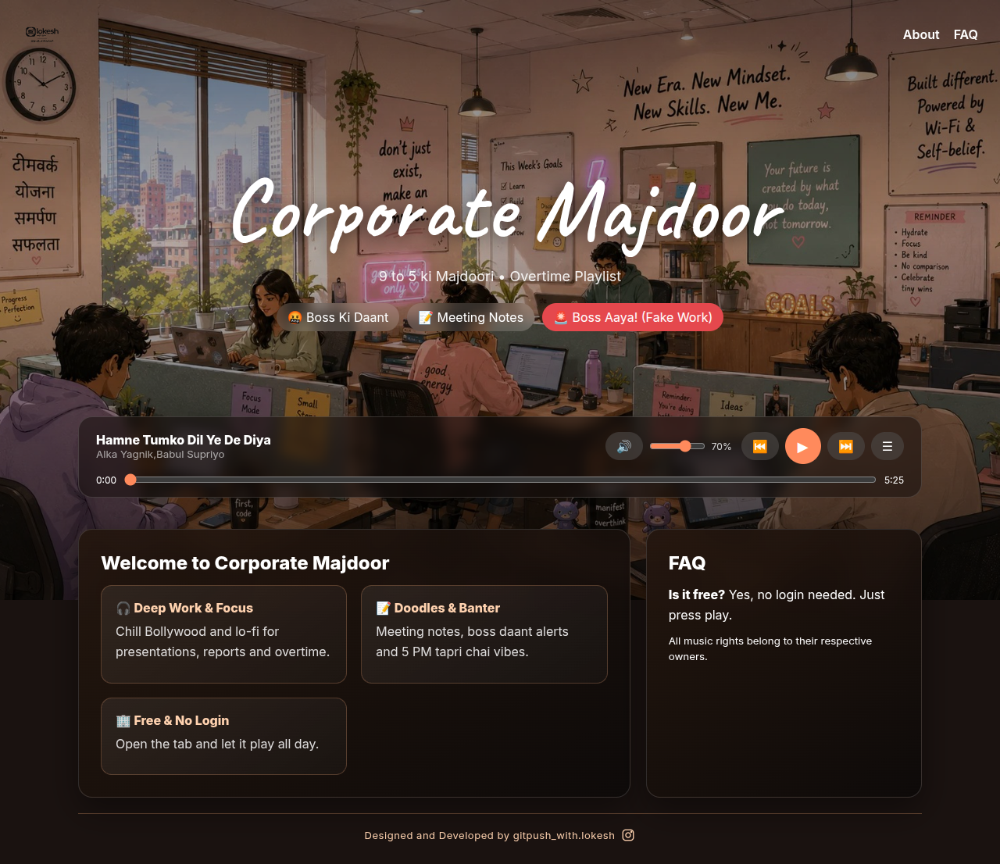

# 💼 Corporate Majdoor

### Corporate Life, Desi Style! 😂

Corporate Majdoor is a modern, interactive and responsive web project inspired by Indian corporate culture, office struggles, workplace humor and desi-style entertainment.

The project brings a fun combination of corporate life and relatable Indian humor through an engaging user interface and creative theme experiences.

## ✨ Features

- 🎨 Modern and attractive user interface
- 📱 Fully responsive design for mobile, tablet and desktop
- 💼 Corporate Majdoor themed experience
- 😂 Desi-style humor and workplace-inspired content
- 🎭 Interactive theme experiences
- ⚡ Fast performance powered by Vite
- 🧩 Reusable React components
- 🌐 Deployed and hosted on Vercel

## 🛠️ Tech Stack

| Technology        | Purpose                       |
| ----------------- | ----------------------------- |
| React.js          | Frontend development          |
| JavaScript (ES6+) | Application logic             |
| Vite              | Development and build tool    |
| HTML5             | Website structure             |
| CSS3              | Styling and responsive design |
| Git & GitHub      | Version control               |
| Vercel            | Deployment                    |

## 📸 Screenshots

```md
## 📸 Screenshots


```

## 🚀 Getting Started

Follow these instructions to run the project locally.

### 1. Clone the repository

```bash
git clone https://github.com/lokeshkumar72/Corporate-Majdoor.git
```

### 2. Navigate to the project directory

```bash
cd Corporate-Majdoor
```

### 3. Install dependencies

```bash
npm install
```

### 4. Start the development server

```bash
npm run dev
```

### 5. Build for production

```bash
npm run build
```

### 6. Preview production build

```bash
npm run preview
```

## 📂 Project Structure

```text
Corporate-Majdoor/
│
├── public/
├── src/
│   ├── assets/
│   ├── App.jsx
│   ├── styles.css
│   └── main.jsx
│
├── index.html
├── package.json
├── vite.config.js
├── .gitignore
└── README.md
```

## 🌐 Live Demo

**Live Website:** https://corporate-majdoor-orcin.vercel.app/

## 📦 Repository

[GitHub – Corporate Majdoor](https://github.com/lokeshkumar72/Corporate-Majdoor)

## 👨‍💻 Author

**Lokesh Kumar Singh**

- GitHub: [@lokeshkumar72](https://github.com/lokeshkumar72)
- LinkedIn: [Lokesh Kumar Singh](https://www.linkedin.com/in/lokesh-kumar-singh-/)

## 🤝 Contributing

Contributions, suggestions and improvements are welcome!

1. Fork the repository.
2. Create a new branch.
3. Make your changes.
4. Commit your changes.
5. Submit a pull request.

## 📄 License

This project is open for learning and personal development. Add a license file if you intend to distribute it under a specific open-source license.

---

<p align="center">
  **Made with ❤️ and ☕ by Lokesh Kumar Singh**
  
  *Corporate Life, Desi Style!*
</p>
